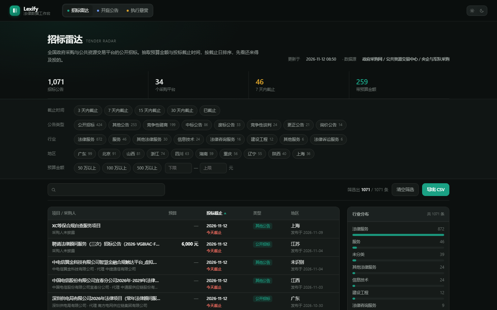
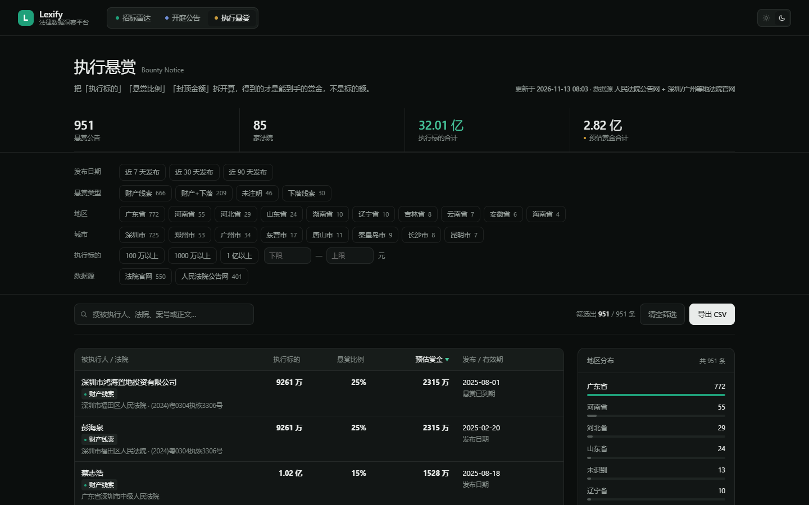

# Lexify

**法律数据洞察平台**。把散落在法院公告网、公共资源交易平台上的公开信息，拆成可筛选的字段，还原成一张**法律服务需求地图**：谁在打官司、标的多少、谁在花钱买法律服务。

三个看板分别对应需求的不同阶段：**招标雷达**是已经标价的需求（谁在采购、预算多少），**开庭公告**是还没人替它说出口的需求（谁刚被起诉、还没请律师），**执行悬赏**是需求的下游（钱在执行阶段卡住了）。

不做案源买卖，不做可外呼的个人名录——交付的是展业判断的依据，不是客户名单。

| 首页 | 招标雷达 | 开庭公告 | 执行悬赏 |
|---|---|---|---|
|  |  |  |  |

---

## 现在有什么

| 看板 | 数据量 | 回答的问题 | 关键字段 |
|---|---|---|---|
| 招标雷达 `tender.html` | 1,071 条 | 哪些法律服务采购还在投标期内 | 预算、投标截止、采购人、行业、地区 |
| 开庭公告 `hearing.html` | 5,278 条 | 哪个企业刚收到传票、还没委托律师 | 开庭时间、被告类型、案由、涉案金额、法院 |
| 执行悬赏 `bounty.html` | 951 条 | 哪个被执行人值得提供线索 | 执行标的、悬赏比例、预估赏金、有效期 |

首页 `index.html` 汇总三者：7,300 条结构化公告、477 家法院与采购机构、31 个省级行政区。**首页所有数字都由 `web/data/overview.js` 驱动**，不在 HTML 里写死，数据更新后文案不会对不上。

三块看板共用同一套交互：左侧筛选（多选 / 日期预设 / 金额区间）、表头排序、关键词搜索（含公告正文）、分页、右侧分布面板与快捷口径、详情弹窗、CSV 导出。深色 / 浅色主题跟随系统并可手动切换。

---

## 目录结构

```
lexify/
├─ web/                     # 站点本体，纯静态，零依赖
│  ├─ index.html            # 首页：hero + 三张看板卡片 + 为什么不是获客工具 + 路线图 + 数据源
│  ├─ tender.html           # 三个看板页：外壳完全一致，差别只在 LexBoard({...}) 配置
│  ├─ hearing.html
│  ├─ bounty.html
│  ├─ style.css             # 设计系统（tokens、主题、首页）
│  ├─ board.css             # 看板页专用（KPI、筛选器、表格、侧栏、弹窗）
│  ├─ app.js                # 首页：数字滚动、⌘K 命令面板、首屏真实记录预览、导航高亮
│  ├─ board.js              # 看板引擎：筛选 / 排序 / 分页 / 渲染 / 导出，配置驱动
│  └─ data/                 # 由 scripts/build_data.py 生成，不要手改
│     ├─ tender.js  hearing.js  bounty.js
│     └─ overview.js
├─ docs/                    # README 顶部四张截图（1440×900，深色主题）
├─ scripts/
│  └─ build_data.py         # 从两个 SQLite 源库导出上面 4 个文件
├─ tests/
│  ├─ test_static.py        # 静态自检 86 项：离线自洽、链接、数据一致性、类名不撞车
│  ├─ run_ui_test.py        # 交互回归 175 项：跑无头浏览器点真页面
│  └─ selftest_board.js     # 上面那套断言，三个看板共用一份
├─ Dockerfile
├─ docker-compose.yml
└─ docker/
   └─ nginx.conf            # gzip、缓存分档、安全头
```

`web/` 不依赖任何 CDN、外部字体或构建工具，双击 `index.html` 也能跑（`file://` 下同样可用，数据以 `window.__BOARD__ = {...}` 的形式加载，不走 `fetch`）。

---

## 快速开始

```bash
# 起个静态服务（推荐，避免个别浏览器对 file:// 的限制）
python -m http.server 8899 --directory web
# 打开 http://127.0.0.1:8899/
```

重新导出数据（源库有更新时）：

```bash
python scripts/build_data.py
# 或指定源库路径
python scripts/build_data.py --tender-db /path/tender.db --court-db /path/bounty.db
```

两个源库按下面的顺序查找，一条都不用改代码：

1. 命令行参数 `--tender-db` / `--court-db`
2. 环境变量 `LEXIFY_TENDER_DB` / `LEXIFY_COURT_DB`
3. 与 `lexify/` 同级的 `tender-radar/data/tender.db`、`bounty-radar/data/bounty.db`
4. 本机常见位置：`~/Desktop` 与 `~/WorkBuddy/*` 下的同名 `*-radar/data/*.db`

开庭与悬赏共用 `bounty.db`。找不到库时脚本直接报出期望路径并退出，不会导出空数据。

---

## 数据怎么来

Lexify **不碰采集，也不改源库**。它只做「读 → 归一 → 写 JS」：

```
tender.db ─┐
           ├─ build_data.py ─→ web/data/*.js ─→ 浏览器
bounty.db ─┘   (只读)
```

两个源项目保持独立：

- 招标：[bytemineur/tender-radar](https://github.com/bytemineur/tender-radar)
- 法院两块：bounty-radar（开庭传票 + 执行悬赏同一套采集器）

法院数据的覆盖范围（都在 bounty-radar 里配置）：

| 区域 | 法院 | 来源 |
|---|---|---|
| 深圳 | 中院 + 10 个区法院 | 各法院官网公告栏目 + 开庭排期表 + 人民法院公告网 |
| 广州 / 东莞 / 惠州 | 21 家基层法院（含广州互联网法院） | 全部走人民法院公告网，按法院检索 |

珠三角这批法院没有可用的官网悬赏/排期栏目，开庭时间只能从传票正文解析，
所以「排期」是逐案的（`heaAt` + `room`），不是深圳盐田那种一张表看一周。

导出时做了几件必要的事：

1. **招标去重**：只取 `is_primary IS NOT 0 OR cluster_id IS NULL`，把同一条公告的多次转载收敛成一条（1,489 → 1,071）。
2. **省份归一**：招标记「吉林」、法院记「吉林省」，不归一化会把同一个省算成两个（曾经算出 61 个省）。`norm_prov()` 统一剥掉 省 / 市 / 自治区 后缀。
3. **正文快照**：`content` 全文最多保留 8,000 字，随数据一起下发。这样点开详情看的是本地快照，不依赖源站能不能打开。
4. **天数重算**：`days` 不落库，页面加载时用 `daysFrom()` 现算，避免数据放几天后「还剩 3 天」变成错的。

---

## 新增一个看板

这是设计时刻意压到最低成本的地方：**新增看板 = 一份数据 + 一份配置，不改引擎**。

以「执行案件」为例：

**① 在 `scripts/build_data.py` 里加一个 `build_enforce(db_path)`**

照着 `build_hearing()` 抄，返回：

```python
{
    "key": "enforce",
    "name": "执行案件",
    "en": "Enforcement",
    "tagline": "……",
    "rows": [...],        # 每行一个 dict，字段名随你定
    "meta": {"generatedAt": "...", "total": len(rows), ...},
}
```

在 `main()` 的 `boards` 里加 `"enforce": build_enforce(args.court_db)`。首页汇总、省份并集会自己跟上。

**② 复制 `web/hearing.html` 为 `web/enforce.html`**，改三处：

- `<title>` / `<meta name="description">`
- `<body class="board-enforce">`（模块主色，见 `board.css` 里的 `--mc`）
- 顶部 `btabs` 导航里加 `<a href="enforce.html" data-b="enforce"><i class="bdot"></i>执行案件</a>`，并给当前页加 `class="on"`
- 最后一行 `<script src="data/hearing.js">` 改成 `data/enforce.js`

**③ 写 `LexBoard({...})` 配置**（同一份 HTML 底部，参考下表）。

**④ 首页 `index.html`** 在 `#boards` 里复制一张 `.card`，改 `data-m` 绑定的字段；路线图（`.roadmap` 区块，锚点仍是 `#soon`）里把对应那张卡挪出来。

**⑤ 回归**：`python tests/test_static.py && python tests/run_ui_test.py`
`test_static.py` 里的 `BOARDS` 加一行、`run_ui_test.py` 的 `SUITES` 加一行，两个页面就纳入自动校验。

### 配置字段

| 字段 | 作用 |
|---|---|
| `title` / `en` / `tagline` | 页头三行文字 |
| `dateField` | 哪一列是日期基准（供日期预设与倒计时用） |
| `amountField` | 金额筛选比较哪个字段，默认 `amount` |
| `search` | 关键词搜索覆盖的字段数组（可含 `body`） |
| `kpis` | 4 个 KPI：`{ label, value(rows, meta), fmt: "money"/"yi", tone: "accent"/"warn"/"hot" }` |
| `dayPresets` | 日期预设：`{ key, label, test(days) }`，`days` 为距今天数，负数是过去 |
| `facets` | 左侧筛选器，四种类型见下 |
| `columns` | 表格列，隐藏列仍可进搜索与 CSV |
| `sort` | 默认排序 `{ key, dir }` |
| `pageSize` | 每页条数，默认 20 |
| `presets` | 右侧「快捷口径」：`{ label, test(row), apply(state) }` |
| `dist` | 右侧分布面板：`{ label, field, top, emptyLabel, labelOf }` |
| `detail` | 详情弹窗内容：返回 `{ title, sub, kv: [[键, 值], ...] }` |
| `metaExtra` | 页头「更新于 …」后面追加的 HTML（比如标注数据源） |
| `asideNote` | 右侧底部说明文字 |

**四种筛选器**

```js
{ key: "defType", label: "被告类型", type: "multi", field: "defType",
  top: 10,                         // 只显示前 N 项（不填则全显示）
  labelOf: function (k) { return LABEL[k] || k } }   // 显示名映射，同时也是归一键

{ key: "days", label: "开庭时间", type: "days" }      // 用 CFG.dayPresets

{ key: "amount", label: "涉案金额", type: "amount", unit: "元",
  presets: [{ label: "100 万以上", min: 1000000, max: null }] }

{ key: "comm", label: "只看商事", type: "bool",
  options: [{ label: "是", value: "1" }], test: function (r, v) { return r.comm } }
```

`labelOf` 是这套引擎里最容易被忽略的字段，它同时解决三个问题：筛选器显示中文而不是 `property` / `rmfygg_kt` 这类枚举、把 `吉林省` 与 `吉林` 合并成一项、让快捷口径写原始枚举值也能正确过滤（引擎在每次过滤前会把选择项统一归一到显示名）。

**表格列**

```js
{ key: "amount", label: "涉案金额", cls: "num", w: "14%", firstDir: "desc",
  render: function (r) { return "<b>" + money(r.amount) + "</b>" },
  sortVal: function (r) { return score(r) },   // 可选：排序用另一套值
  csvVal: function (r) { return r.amount },    // 可选：导出用原始值
  hidden: true,                                 // 不在表格显示，但仍进搜索与 CSV
  sortable: false }
```

表格是 `table-layout: fixed`，**列宽必须用 `w` 显式给**，否则长中文列会被压成一字一行。金额列记得带 `cls: "num"`（有最小宽度，避免「639 万」的「万」被吃掉）。

---

## 两条会反复踩的约定

**一、CSS 类名带模块前缀。** 整个站点共用一张全局样式表，没有 scope，裸类名 `.hot` / `.soon` 已经造成过三次事故：首页「常用检索」的 `.hot`（`display:flex` + 12px）把 KPI 的数字挤成行内、字号缩水；路线图区块的 `.soon`（`padding: 72px 0 8px`）把首屏预览的倒计时顶到整行之外，表格里的「7 天内截止」也被加了 72px 上内边距。规则：

| 场景 | 写法 |
|---|---|
| 语义态 | 挂在模块类下 `.days.soon`，或带前缀 `.kpi--hot` |
| 模块内 | `.pv-row` / `.bhead-meta` |
| 整块区域 | `.roadmap`（不叫 `.soon`） |

`test_static.py` 里有一条断言兜底：CSS 顶层不允许定义 `soon / past / week / hot / warn / money / accent / on` 这些裸类。

**二、数字和文案都从数据走。** 首页指标用 `data-m="boards.hearing.total"` 绑定，取不到值会静默跳过 —— 于是会出现「HTML 里写死 1,735、实际数据 5,278」这类没人发现的偏差。测试里也有一条断言：`index.html` 里每个 `data-m` 都必须在 `overview.js` 里取到值，取不到就 FAIL。

---

## 自测

```bash
python tests/test_static.py      # 86 项，秒级，无需浏览器
python tests/run_ui_test.py      # 175 项（三块看板各 57–59 项），无头 Chrome / Edge 点真页面
python tests/run_ui_test.py bounty   # 只跑一块
```

静态检查管的是「站点还完整吗」：没有外部 CDN、所有相对链接都存在、`data/*.js` 是合法 JSON、行数等于 `meta.total`、首页汇总等于三块之和、省份没有「吉林省 / 吉林」并存、每个页面的挂载点和导航高亮齐全、**CSS 里没有会导致互相踩的裸状态类**。

交互回归管的是「点下去还对吗」：多选筛选的条数是否等于 chip 上的计数、日期预设结果是否全在区间内、金额区间是否真的生效、排序是否单调且空值恒沉底、翻页是否换页、搜索是否全命中、无结果是否有空态、详情能否打开与 Esc 关闭、快捷口径条数是否与标注一致、CSV 行数是否等于结果数、侧栏分布是否不越界、界面有没有漏出英文枚举值、**表头有没有被挤成竖排、单元格有没有裁掉金额单位**、运行期有没有未捕获异常。

测试脚本对页面零侵入：临时 HTML 写在 `web/` 下（保证相对路径能取到 `data/*.js`），跑完即删。

---

## 部署

两种起法，都实测过：

| 方式 | 命令 | 适用 |
|---|---|---|
| Python 静态服务 | `python -m http.server 8899 --directory web` → `http://127.0.0.1:8899` | 本地改页面、给同事看一眼 |
| Docker | `docker compose up -d --build` → `http://127.0.0.1:8080` | 常驻，放到 VPS 上对内或对外提供服务 |

### 实测对比

测的是最重的一页 `hearing.html`（数据 7.3 MB，加载完渲染 20 行表格），两种方式页面内容与交互完全一致，均无 console 报错：

| 指标 | Python `http.server` | Docker `nginx:alpine` |
|---|---|---|
| 本机环回加载 | 437 ms | 528 ms |
| 实际传输字节 | 7,362,031（不压缩） | 1,066,868（gzip 后 14.5%） |
| 限速 16 Mbps | 3.55 s | 0.49 s |
| 限速 4 Mbps | 13.96 s | 2.06 s |
| 限速 2 Mbps | 28.33 s | 4.11 s |
| 并发 100 请求 | 0.58 s / 171 QPS | 0.17 s / 578 QPS |
| 缓存头 | 无 | `data/` 走 `no-cache`，css/js 1 小时，图片 7 天 |
| 安全头 | 无 | nosniff / SAMEORIGIN / strict-origin-when-cross-origin |
| 访问 `/data/` | 直接列出文件名 | 403 |
| 不存在的路径 | 带目录列表的 404 | 干净 404 |

本机环回上 Docker 反而慢 90 ms —— 环回带宽无限，gzip 压 7 MB 的 CPU 开销换不来传输时间的节省。但真实链路上压缩比是 7:1，7 MB 变 1 MB，20 Mbps 以下全是 7 倍差距。

结论：**本地看页面用 Python 起更快，真要部署用 Docker。**

`nginx.conf` 里的缓存策略用一张 `map` 出值、`add_header` 只在 server 级写一次。原因见文件内注释：`add_header` 只要在 location 块里出现，该块就不再继承 server 级的头 —— 早先逐 location 写 `Cache-Control` 的版本，`/data/*.js` 与 `*.css` 的响应把三个安全头整块丢了。

### 数据更新

数据是 `COPY web/` 打进镜像的，**`docker compose restart` 不会重新读宿主机的 `web/data`**。实测：宿主机新增一个数据文件后 restart，容器内仍是旧内容（404）。要么重建，要么挂卷：

```bash
python scripts/build_data.py
docker compose up -d --build      # 重建，约 10 秒（基础层有缓存）
```

想省掉每次重建，把 `docker-compose.yml` 里的 volume 注释打开。**挂 `./web` 整目录，不要只挂 `data`**——只挂 data 的话改过 `board.js` / `board.css` 不会进容器：

```yaml
volumes:
  - ./web:/usr/share/nginx/html:ro
```

挂载后 `build_data.py` 一跑完刷新浏览器就是新数据，连 restart 都不用（Docker Desktop on Windows 上同样可用，已实测）。

### 其他

镜像只是 `nginx:alpine` 加上 `web/`，没有构建步骤，首次构建约 10 秒。也可以直接把 `web/` 丢到任意静态托管（OSS / Cloudflare Pages / Vercel / GitHub Pages），不需要 Node、不需要后端。

gzip 目前是动态压缩（每次请求现压，7 MB 那次约 180 ms CPU）。访问量起来后可以在构建阶段预生成 `.gz` 并开 `gzip_static`，或者干脆把数据拆成按省份分包，只下发首屏要用的那一份。

---

## 已知边界

- **原文链接可能打不开**：部分法院站点有 Web 应用防火墙，短时间内重复访问详情页会返回 403 拦截页（同一批数据的列表页却正常）。所以详情弹窗以**本地正文快照**为主，「去法院官网看原文」只是次要入口。CSV 导出同样带 `公告正文` 列。
- **数据是快照，不是实时**：页面显示「更新于 …」，刷新数据需要重跑 `build_data.py`。某块的数据可能比另一块旧（比如悬赏的发布日整体偏早），筛选结果为 0 条时先看这个时间。
- **筛选在前端做**：全量数据一次性下发（三块合计约 12 MB，其中开庭一块 7 MB，大头是公告正文快照），换来的是零后端、`file://` 可用、筛选零延迟。数据量再涨一个数量级就要改成服务端分页 —— 那时引擎的 `state` 结构可以原样复用，只换数据源。
- **不做判断**：只做结构化与排序，不给结论、不替代律师意见。

---

## 路线图

| 看板 | 状态 | 数据源 |
|---|---|---|
| 招标雷达 | 已上线 | 全国政府采购 / 公共资源交易平台 |
| 开庭公告 | 已上线 | 法院公告网 + 地方法院排期表 |
| 执行悬赏 | 已上线 | 法院公告网 + 地方法院官网 |
| 执行案件 | 规划中 | 中国执行信息公开网 |
| 破产清算 | 规划中 | 全国企业破产重整案件信息网 |

新增看板的步骤见上文「新增一个看板」——一份数据 + 一份配置。
