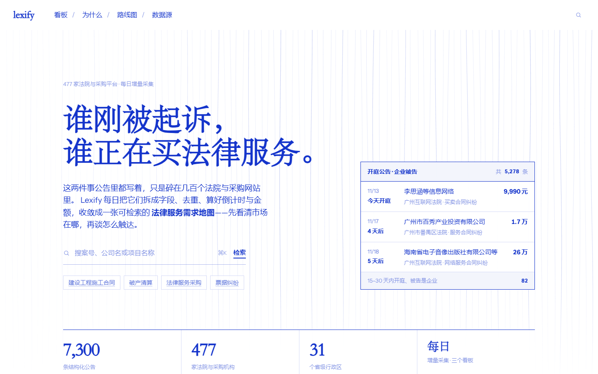
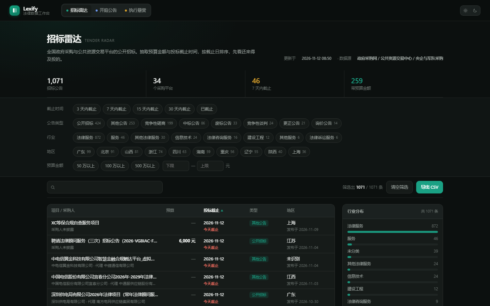
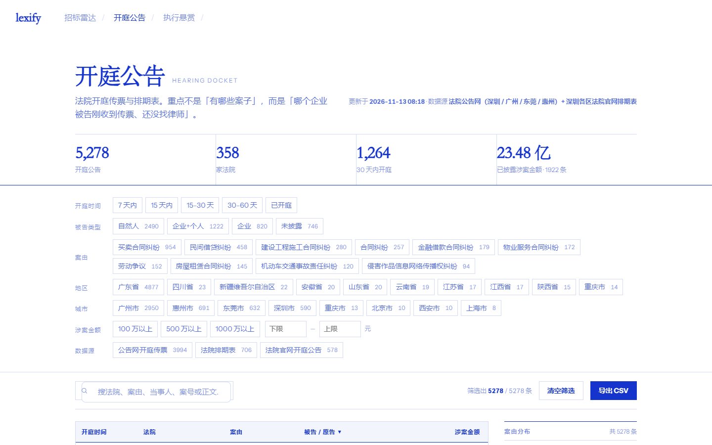
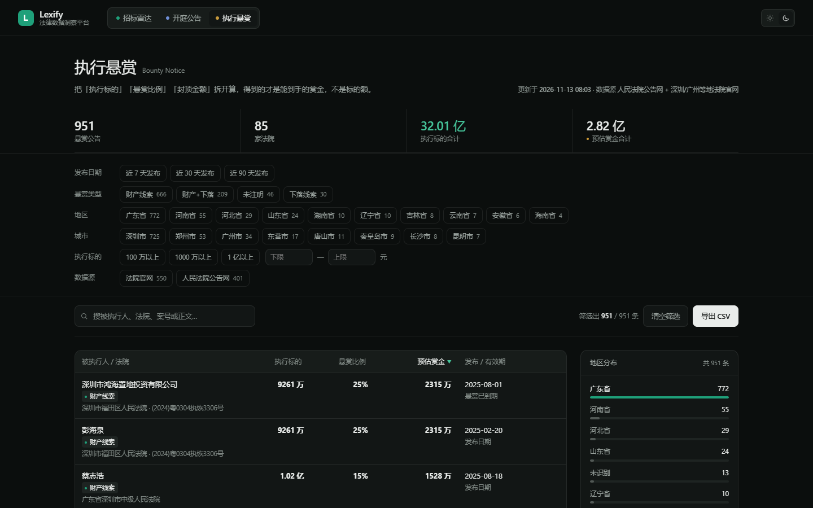

# Lexify

[](https://github.com/bytemineur/lexify/actions/workflows/ci.yml)
[](LICENSE)
[](https://www.python.org)
[](#技术栈)

**法律数据洞察平台**。把散落在法院公告网、公共资源交易平台上的公开信息，拆成可筛选的字段，还原成一张**法律服务需求地图**：谁在打官司、标的多少、谁在花钱买法律服务。

三个看板分别对应需求的不同阶段：**招标雷达**是已经标价的需求（谁在采购、预算多少），**开庭公告**是还没人替它说出口的需求（谁刚被起诉、还没请律师），**执行悬赏**是需求的下游（钱在执行阶段卡住了）。

不做案源买卖，不做可外呼的个人名录——交付的是展业判断的依据，不是客户名单。

| 首页 | 招标雷达 | 开庭公告 | 执行悬赏 |
|---|---|---|---|
|  |  |  |  |

---

## 现在有什么

| 看板 | 数据量 | 回答的问题 | 关键字段 |
|---|---|---|---|
| 招标雷达 `tender.html` | 188 条 | 哪些法律服务采购还在投标期内 | 预算、投标截止、采购人、行业、地区 |
| 开庭公告 `hearing.html` | 5,290 条 | 哪个企业刚收到传票、还没委托律师 | 开庭时间、被告类型、案由、涉案金额、法院 |
| 执行悬赏 `bounty.html` | 952 条 | 哪个被执行人值得提供线索 | 执行标的、悬赏比例、预估赏金、有效期 |

> 上表是当前库的规模，**每天采集后会变**。首页的汇总数字同理，以页面实际显示为准。

首页 `index.html` 汇总三者：6,430 条结构化公告、31 个省级行政区。**首页所有数字都由 `web/data/overview.js` 驱动**，不在 HTML 里写死，数据更新后文案不会对不上。

> 首页不对外展示采集来源（哪些站点、哪些法院）。来源是平台的核心能力，页面只呈现判断结果。

### 前端读的是实时的库，不是快照

页面上的每个数字都由 `server/data.py` 现查 `data/lexify.db` 得到，接口在 `/api/data/*`：

| 接口 | 用途 |
|---|---|
| `GET /api/data/health` | 各表行数、最近一次采集时间（首页数字条用） |
| `GET /api/data/board/<tender\|hearing\|bounty>` | 整块看板数据，结构与导出的 `*.js` 一致 |
| `GET /api/data/stats/overview` | 总量 / 未截止 / 7 天内到期 / 预算合计 |
| `GET /api/data/stats/trend?days=30` | 按日发布趋势 |
| `GET /api/data/stats/dist?dim=province&limit=10` | 区域 / 行业 / 类型 / 来源分布 |
| `GET /api/data/stats/upcoming?days=7` | 即将截止 |
| `GET /api/data/sources` | 采集源状态（真实 `crawl_runs` 记录 + 入库条数） |
| `GET /api/data/tenders?q=&prov=&min=&max=&page=` | 招标列表，服务端筛选 + 分页 |

**为什么这样改**：`web/data/*.js` 是「库 → 导出 → 页面读」的快照，采集一旦停掉，页面还停在旧快照上，
看起来有几千条、库里可能一条没有。现在看板页头标「**实时 · 数据库**」；
只有后端没起或 `file://` 打开时才退回快照，并明确标「**离线快照**」——两种标注措辞不同，不混淆。

**新增的三个页面**（吸收自 tender-radar）：

| 页面 | 定位 |
|---|---|
| `dashboard.html` | 招标看板：指标条 + 发布趋势 + 即将截止 + 区域/来源分布 |
| `radar.html` | 快捷检索：服务端筛选 + 分页 + CSV |
| `sources.html` | 采集来源：每个源是否启用、最近运行结果、真实入库条数、失败原因 |
| `tender.html` | 招标列表（原有）：前端筛选全量数据 + 详情弹窗 + 侧栏分布 |

三块看板共用同一套交互：左侧筛选（多选 / 日期预设 / 金额区间）、表头排序、关键词搜索（含公告正文）、分页、右侧分布面板与快捷口径、详情弹窗、CSV 导出。界面固定浅色（早期版本做过深色主题，为了减少视觉负担已移除）。

---

## 目录结构

```
lexify/
├─ web/                     # 站点本体，纯静态，零依赖
│  ├─ index.html            # 首页：hero + 三张看板卡片 + 数据挖掘定位 + 路线图
│  ├─ tender.html           # 三个看板页：外壳完全一致，差别只在 LexBoard({...}) 配置
│  ├─ hearing.html
│  ├─ bounty.html
│  ├─ style.css             # 基础设计系统（tokens、布局、首页）
│  ├─ board.css             # 看板页专用（KPI、筛选器、表格、侧栏、弹窗）
│  ├─ millennium.css        # 唯一的皮肤：电光蓝单色 + 衬线标题 + 方角 + 1px 发丝线
│  ├─ app.js                # 首页：数字滚动、⌘K 命令面板、首屏真实记录预览、导航高亮
│  ├─ board.js              # 看板引擎：筛选 / 排序 / 分页 / 渲染 / 导出，配置驱动
│  ├─ ai-chat.js            # 右下角 AI 咨询入口：SSE 流式对话，读 /api/ai/*
│  ├─ ai-chat.css           # 咨询面板皮肤（沿用 millennium 的方角 + 发丝线）
│  ├─ field-curtain.js      # 首屏帘子动效；field.svg 是无 JS 时的静态兜底
│  ├─ fonts/                # 自托管字体，不引 Google Fonts
│  ├─ favicon-32/64.png
│  └─ data/                 # 由 scripts/manage.py 从库里导出，不要手改
│     ├─ tender.js  hearing.js  bounty.js
│     └─ overview.js
├─ docs/                    # 说明文档 + 设计资源（docs/assets/）
├─ data/                    # data/schema.sql 进 git；data/lexify.db 不进
├─ collectors/              # 采集器：tender-radar（招标）/ bounty-radar（法院两块）
├─ scripts/
│  ├─ manage.py             # 数据命令：crawl / add / build / push / update / stats / failures
│  ├─ build_data.py         # 库 → web/data 下 4 个文件（由 manage.py 调用）
│  ├─ publish_data.py       # 数据有实质变化才推送 GitHub（由 manage.py 调用）
│  └─ compat.py             # 跨平台底座：控制台 UTF-8、子进程环境、解释器定位
├─ tests/
│  ├─ test_static.py        # 静态自检 120 项：离线自洽、链接、数据一致性、类名不撞车
│  ├─ run_ui_test.py        # 交互回归 175 项：跑无头浏览器点真页面
│  └─ selftest_board.js     # 上面那套断言，三个看板共用一份
├─ server/                  # 站点 + 后台 + AI 的 Python 实现（main.py 只是入口）
│  ├─ ai.py                 # AI 咨询：扫项目建知识库 + DeepSeek 流式对话
│  ├─ web.py                # 路由、静态服务、/api/ai/*
│  ├─ admin.py  auth.py  docs.py  jobs.py  db.py  config.py  cli.py
├─ main.py                  # 唯一入口：站点 + 管理后台 + 定时更新
└─ requirements.txt         # 采集依赖（不跑采集不用装）
```

`web/` 不依赖任何 CDN、外部字体或构建工具，双击 `index.html` 也能跑（`file://` 下同样可用，数据以 `window.__BOARD__ = {...}` 的形式加载，不走 `fetch`）。

---

## 快速开始

三步：**建 conda 环境 → 装依赖 → 起服务**。端口全项目统一用 **8010**
（`main.py` 默认值、文档、示例命令都一样，不要改来改去）。

### 1. 装 Anaconda，新建 lexify 环境（Python 3.12.16）

```bash
# 下载安装器（清华镜像，国内快）
wget -c https://mirrors.tuna.tsinghua.edu.cn/anaconda/archive/Anaconda3-2024.10-1-Linux-x86_64.sh

bash Anaconda3-2024.10-1-Linux-x86_64.sh    # 一路回车，最后一个问句输 yes
source ~/.bashrc                            # 让 conda 命令进当前 shell

conda create -n lexify python=3.12.16 -y
conda activate lexify
python -V                                   # 应输出 Python 3.12.16
```

macOS / Windows 不用这个 `.sh`：装好 Anaconda（或 Miniconda）后，直接从 `conda create` 那步开始。
环境名保持 `lexify`，后面命令都假设已经 `conda activate lexify`——忘记激活是最常见的「装完却 import 不到」。

### 2. 进项目目录，装依赖

```bash
cd lexify
pip install -r requirements.txt -i https://pypi.tuna.tsinghua.edu.cn/simple
```

> 站点、后台、导入导出**只用标准库**，不装也能起；`requirements.txt` 里是**采集**要用的东西
> （sqlalchemy / httpx / parsel / pyyaml / playwright）。一次装齐，省得以后跑 `crawl` 才缺包。
>
> 其中 playwright 还要单独下浏览器内核（约 150 MB），只在抓有 WAF 的站点时才用得上：
>
> ```bash
> playwright install chromium
> ```

### 3. 启动

```bash
python main.py
```

| 地址 | 是什么 |
|---|---|
| http://127.0.0.1:8010/ | 站点（四个页面） |
| http://127.0.0.1:8010/admin | 数据后台 |
| http://127.0.0.1:8010/docs | 项目文档（含实时表结构） |

**进后台**：本机直连不用口令；从别的机器访问要带口令（首次启动自动生成在 `data/admin_token.txt`），
详见下文「部署 · 后台怎么进」。

> 只想浏览仓库里已提交的数据快照，不需要后台和定时更新，也可以退化成纯静态服务：
> `python -m http.server 8010 --directory web`。

数据只有一份：`data/lexify.db`。网页读的 `web/data/*.js` 是它导出的快照。

```bash
python scripts/manage.py crawl            # 三块一起采 → 去重入库 → 自动重新导出
python scripts/manage.py crawl --only tender --pages 5   # 只采招标，并覆盖各站点的翻页数
python scripts/manage.py add 新数据.db    # 外部数据入库（去重）+ 自动重新导出
python scripts/manage.py stats            # 看库里有什么
python scripts/manage.py failures         # 看采集/导入失败记录
```

> **翻页默认按各站点自己的 `pagination.max_pages` 走**（1~20 页不等，见
> `collectors/tender/configs/sites/*.yaml`）。`--pages N` 是**覆盖**而不是下限——早期版本
> 这里写死 `--pages 1`，把每个站点的配置都压成一页，采集量从上千条掉到百来条。
> 想采得更全就删掉这个参数，别随手传 1。
>
> 库里某一块是 0 条时（采集失败、刚重建库）**不会**用空数据覆盖 `web/data/*.js`，
> 线上保留上一次的快照，避免整块看板突然变空白。

命令在 Windows / macOS / Linux 上都一样：把 `python` 换成 `python3`（Linux/macOS 未激活 conda 时）即可，
脚本内部用 `sys.executable` 调子进程，不依赖 cmd 批处理或 shell 管道。

| 平台 | 起服务 | 跨平台细节 |
|---|---|---|
| Windows | `python main.py` | 启动时自动把控制台代码页切到 UTF-8，`✓ ▶ ⚠` 这类符号不会抛 `UnicodeEncodeError` |
| macOS | `python3 main.py` | 同上，无需额外配置 |
| Linux | `python3 main.py` | 同上；常驻建议走 systemd，见 DEPLOY |

库路径默认 `data/lexify.db`，可用环境变量 `LEXIFY_DB` 改。

---

## 数据怎么来

采集器在 `collectors/` 里，三个采集器已经并进来（不再依赖外部仓库）。

```
manage.py crawl
   ├─ collectors/tender   ─┐
   ├─ collectors/bounty   ─┤
   └─ collectors/hearing  ─┴─→ data/lexify.db（直接写，去重靠唯一键）
                                    │
                                    ▼ build
                            web/data/*.js
```

法院数据的覆盖范围：

| 区域 | 法院 | 来源 |
|---|---|---|
| 深圳 | 中院 + 10 个区法院 | 各法院官网公告栏目 + 开庭排期表 + 人民法院公告网 |
| 广州 / 东莞 / 惠州 | 21 家基层法院（含广州互联网法院） | 全部走人民法院公告网，按法院检索 |

珠三角这批法院没有可用的官网悬赏/排期栏目，开庭时间只能从传票正文解析，
所以「排期」是逐案的（`heaAt` + `room`），不是深圳盐田那种一张表看一周。

导出时做了几件必要的事：

1. **招标去重**：只取 `is_primary IS NOT 0 OR cluster_id IS NULL`，把同一条公告的多次转载收敛成一条（例：库里 223 条 → 页面 188 条）。
2. **省份归一**：招标记「吉林」、法院记「吉林省」，不归一化会把同一个省算成两个（曾经算出 61 个省）。`norm_prov()` 统一剥掉 省 / 市 / 自治区 后缀。
3. **正文快照**：`content` 全文最多保留 8,000 字，随数据一起下发。这样点开详情看的是本地快照，不依赖源站能不能打开。
4. **天数重算**：`days` 不落库，页面加载时用 `daysFrom()` 现算，避免数据放几天后「还剩 3 天」变成错的。

---

---

## AI 咨询入口

每个页面右下角有一个「咨询」按钮，点开是对话面板。模型扮演客服，**答案来自这个项目本身**：
提问时 `server/ai.py` 会扫一遍项目文件夹（README、docs、目录树、库里的表规模、首页汇总数字），
整理成知识库塞进系统提示词，所以它能准确说出三个看板各有多少条、字段是什么、怎么部署，
也不会替访客编造价格或功能。

### 开启

只要服务端能拿到 DeepSeek 的 Key，入口就自动出现；拿不到就自动隐藏（不会留一个点不通的按钮）。

| 优先级 | 来源 |
|---|---|
| 1 | 环境变量 `LEXIFY_AI_API_KEY` |
| 2 | 环境变量 `DEEPSEEK_API_KEY` |
| 3 | DSH 凭据文件 `~/.dsh/.credentials.yaml` 里的 `DEEPSEEK_API_KEY`（装了 DeepSeek Harness 时自动复用） |

```bash
# Windows PowerShell
$env:DEEPSEEK_API_KEY = "sk-..."
python main.py

# macOS / Linux
export DEEPSEEK_API_KEY=sk-...
python3 main.py
```

启动日志里会有一行 `AI 咨询：已启用 · 模型 deepseek-flash · Key 来源：…`，对得上就说明接通了。

> Key 只在服务端使用：不下发到浏览器、不进日志、不在前端代码里出现。

### 可调参数

| 环境变量 | 默认 | 作用 |
|---|---|---|
| `LEXIFY_AI_MODEL` | `deepseek-flash` | 模型 id（也可用 `deepseek-v4-pro`） |
| `LEXIFY_AI_BASE_URL` | `https://api.deepseek.com` | 兼容 OpenAI 协议的网关地址 |
| `LEXIFY_AI_THINKING` | `off` | 客服场景默认关掉思考模式，先出字 |
| `LEXIFY_AI_TIMEOUT` | `90` | 单次上游请求超时（秒） |
| `LEXIFY_AI_RATE` | `20` | 每个 IP 每分钟最多问几次 |
| `LEXIFY_AI_CONCURRENCY` | `4` | 同时进行的对话上限（防止一把 Key 被刷爆） |
| `LEXIFY_AI_DISABLED` | — | 设成 `1` 彻底关闭入口 |

命令行不用记这些：`python main.py --no-ai` 就能关掉 AI 入口。

### 实现要点

- **接口**：`POST /api/ai/chat`，`{"message": "...", "history": [...], "stream": true}`，
  流式返回 SSE（`event: delta` 逐字 / `done` / `error`）；不带 `stream` 就返回整段 JSON。
  `GET /api/ai/status` 只回「开没开、用的哪个模型、知识库有多少文件」，供前端决定显不显示入口。
- **安全**：这个 POST 不走后台口令（访客都要能用），改为**同源校验**（挡第三方站点盗刷）+
  **每 IP 限流** + **全局并发上限** + 请求体 64 KB 上限。它不碰数据库、不写盘。
- **知识库**：只读白名单扩展名，跳过 `.git` / `data` / 字体 / 图片；单文件 400 KB、
  单篇摘要 2,600 字、总预算 26,000 字封顶，避免把整份 README 和所有源码倒进 context。
  结果按文件 mtime 缓存 10 分钟——**改了文档想立刻生效，重启一下进程**即可。
- **不越界**：提示词里固定住了三条硬边界——不给法律意见、不做案源买卖、数据只报知识库里的数。
  问到价格/商务，它会请对方留联系方式并转交，不自己报价。

只想浏览页面、不需要 AI 时，什么都不配就行：`web/` 仍然零依赖，`file://` 打开也照常工作
（`ai-chat.js` 检测到 `file:` 协议会直接跳过，不去请求接口）。

---

## 新增一个看板

这是设计时刻意压到最低成本的地方：**新增看板 = 一份数据 + 一份配置，不改引擎**。

以「执行案件」为例：

**① 在 `scripts/build_data.py` 里加一个 `build_enforce(db_path)`**

照着 `build_hearing()` 抄，返回：

```python
{
    "key": "enforce",
    "name": "执行案件",
    "en": "Enforcement",
    "tagline": "……",
    "rows": [...],        # 每行一个 dict，字段名随你定
    "meta": {"generatedAt": "...", "total": len(rows), ...},
}
```

在 `main()` 的 `boards` 里加 `"enforce": build_enforce(args.court_db)`。首页汇总、省份并集会自己跟上。

**② 复制 `web/hearing.html` 为 `web/enforce.html`**，改三处：

- `<title>` / `<meta name="description">`
- `<body class="board-enforce">`（模块主色，见 `board.css` 里的 `--mc`）
- 顶部 `btabs` 导航里加 `<a href="enforce.html" data-b="enforce"><i class="bdot"></i>执行案件</a>`，并给当前页加 `class="on"`
- 最后一行 `<script src="data/hearing.js">` 改成 `data/enforce.js`

**③ 写 `LexBoard({...})` 配置**（同一份 HTML 底部，参考下表）。

**④ 首页 `index.html`** 在 `#boards` 里复制一张 `.card`，改 `data-m` 绑定的字段；路线图（`.roadmap` 区块，锚点仍是 `#soon`）里把对应那张卡挪出来。

**⑤ 回归**：`python tests/test_static.py && python tests/run_ui_test.py`
`test_static.py` 里的 `BOARDS` 加一行、`run_ui_test.py` 的 `SUITES` 加一行，两个页面就纳入自动校验。

### 配置字段

| 字段 | 作用 |
|---|---|
| `title` / `en` / `tagline` | 页头三行文字 |
| `dateField` | 哪一列是日期基准（供日期预设与倒计时用） |
| `amountField` | 金额筛选比较哪个字段，默认 `amount` |
| `search` | 关键词搜索覆盖的字段数组（可含 `body`） |
| `kpis` | 4 个 KPI：`{ label, value(rows, meta), fmt: "money"/"yi", tone: "accent"/"warn"/"hot" }` |
| `dayPresets` | 日期预设：`{ key, label, test(days) }`，`days` 为距今天数，负数是过去 |
| `facets` | 左侧筛选器，四种类型见下 |
| `columns` | 表格列，隐藏列仍可进搜索与 CSV |
| `sort` | 默认排序 `{ key, dir }` |
| `pageSize` | 每页条数，默认 20 |
| `presets` | 右侧「快捷口径」：`{ label, test(row), apply(state) }` |
| `dist` | 右侧分布面板：`{ label, field, top, emptyLabel, labelOf }` |
| `detail` | 详情弹窗内容：返回 `{ title, sub, kv: [[键, 值], ...] }` |
| `metaExtra` | 页头「更新于 …」后面追加的 HTML（可选，当前三块看板都没用） |
| `asideNote` | 右侧底部说明文字 |

**四种筛选器**

```js
{ key: "defType", label: "被告类型", type: "multi", field: "defType",
  top: 10,                         // 只显示前 N 项（不填则全显示）
  labelOf: function (k) { return LABEL[k] || k } }   // 显示名映射，同时也是归一键

{ key: "days", label: "开庭时间", type: "days" }      // 用 CFG.dayPresets

{ key: "amount", label: "涉案金额", type: "amount", unit: "元",
  presets: [{ label: "100 万以上", min: 1000000, max: null }] }

{ key: "comm", label: "只看商事", type: "bool",
  options: [{ label: "是", value: "1" }], test: function (r, v) { return r.comm } }
```

`labelOf` 是这套引擎里最容易被忽略的字段，它同时解决三个问题：筛选器显示中文而不是 `property` / `rmfygg_kt` 这类枚举、把 `吉林省` 与 `吉林` 合并成一项、让快捷口径写原始枚举值也能正确过滤（引擎在每次过滤前会把选择项统一归一到显示名）。

**表格列**

```js
{ key: "amount", label: "涉案金额", cls: "num", w: "14%", firstDir: "desc",
  render: function (r) { return "<b>" + money(r.amount) + "</b>" },
  sortVal: function (r) { return score(r) },   // 可选：排序用另一套值
  csvVal: function (r) { return r.amount },    // 可选：导出用原始值
  hidden: true,                                 // 不在表格显示，但仍进搜索与 CSV
  sortable: false }
```

表格是 `table-layout: fixed`，**列宽必须用 `w` 显式给**，否则长中文列会被压成一字一行。金额列记得带 `cls: "num"`（有最小宽度，避免「639 万」的「万」被吃掉）。

---

## 两条会反复踩的约定

**一、CSS 类名带模块前缀。** 整个站点共用一张全局样式表，没有 scope，裸类名 `.hot` / `.soon` 已经造成过三次事故：首页「常用检索」的 `.hot`（`display:flex` + 12px）把 KPI 的数字挤成行内、字号缩水；路线图区块的 `.soon`（`padding: 72px 0 8px`）把首屏预览的倒计时顶到整行之外，表格里的「7 天内截止」也被加了 72px 上内边距。规则：

| 场景 | 写法 |
|---|---|
| 语义态 | 挂在模块类下 `.days.soon`，或带前缀 `.kpi--hot` |
| 模块内 | `.pv-row` / `.bhead-meta` |
| 整块区域 | `.roadmap`（不叫 `.soon`） |

`test_static.py` 里有一条断言兜底：CSS 顶层不允许定义 `soon / past / week / hot / warn / money / accent / on` 这些裸类。

**二、数字和文案都从数据走。** 首页指标用 `data-m="boards.hearing.total"` 绑定，取不到值会静默跳过 —— 于是会出现「HTML 里写死 1,735、实际数据 5,278」这类没人发现的偏差。测试里也有一条断言：`index.html` 里每个 `data-m` 都必须在 `overview.js` 里取到值，取不到就 FAIL。

---

## 自测

```bash
python tests/test_static.py      # 120 项，秒级，无需浏览器
python tests/run_ui_test.py      # 175 项（三块看板各 57–59 项），无头 Chrome / Edge 点真页面
python tests/run_ui_test.py bounty   # 只跑一块
```

静态检查管的是「站点还完整吗」：没有外部 CDN、所有相对链接都存在、`data/*.js` 是合法 JSON、行数等于 `meta.total`、首页汇总等于三块之和、省份没有「吉林省 / 吉林」并存、每个页面的挂载点和导航高亮齐全、**CSS 里没有会导致互相踩的裸状态类**。

交互回归管的是「点下去还对吗」：多选筛选的条数是否等于 chip 上的计数、日期预设结果是否全在区间内、金额区间是否真的生效、排序是否单调且空值恒沉底、翻页是否换页、搜索是否全命中、无结果是否有空态、详情能否打开与 Esc 关闭、快捷口径条数是否与标注一致、CSV 行数是否等于结果数、侧栏分布是否不越界、界面有没有漏出英文枚举值、**表头有没有被挤成竖排、单元格有没有裁掉金额单位**、运行期有没有未捕获异常。

测试脚本对页面零侵入：临时 HTML 写在 `web/` 下（保证相对路径能取到 `data/*.js`），跑完即删。

---

## 部署

**一个 Python 进程，没有 Docker，没有 nginx。** `main.py` 同时做三件事：发静态站点、提供管理后台、按点跑数据更新。

环境、依赖、首次启动见上面的「快速开始」，服务器上只是多了**常驻**和**后台口令**两件事：

```bash
conda activate lexify                  # 别忘了，systemd 里也一样要用这个环境
git pull                               # 代码更新
python3 scripts/manage.py init         # 第一次：建库（不建也行，add 会自动建）
python3 main.py                        # → http://<服务器>:8010/
```

> 部署时**整个 `web/` 目录一起传**——里面除了页面还有 1.26 MB 字体子集。
> 漏传字体，中文会回退成系统字体（详见 [docs/DEPLOY.md §4.5](docs/DEPLOY.md)）。

| 地址 | 是什么 | 谁能进 |
|---|---|---|
| `http://<服务器>:8010/` | 站点 | 所有人 |
| `http://<服务器>:8010/admin` | 管理后台 | 本机直连，或带口令 |
| `http://<服务器>:8010/docs` | 项目文档（含实时表结构） | 所有人 |

**后台怎么进**（这条以前最容易卡住）：`/admin` 能采集、上传、推仓库，所以默认只允许本机直连。
从公网打开会看到一个「需要口令」的页面，口令按顺序取：

1. `--admin-token` / 环境变量 `LEXIFY_ADMIN_TOKEN`（自己指定最放心）
2. `data/admin_token.txt`（首次启动自动生成，权限 600）
3. 启动日志里那行「后台口令」

拿到后两种任选一个：URL 加 `?token=…`，或直接贴进那个页面的输入框。
**贴过一次会记进 Cookie（30 天）**，之后点按钮、传文件都不会再 403 —— 表单 POST 是带不上 URL 参数的，这也是之前「能打开页面但一点按钮就 403」的原因。

不想把后台开在公网？用 SSH 隧道：`ssh -L 8010:127.0.0.1:8010 用户@服务器`，
然后在本机开 `http://127.0.0.1:8010/admin`，走的是本机直连，不用口令。

常用参数：`--port` / `--at 00:30` / `--no-schedule` / `--admin-only` / `--admin-token` / `--admin-open` / `--run-now`。
常驻用 systemd，写法见 [`docs/DEPLOY.md`](docs/DEPLOY.md)。

### 为什么不再需要反代

`main.py` 自带 gzip，压缩结果按文件修改时间缓存在内存里。实测最重的一页（`hearing.html`，数据 7.3 MB）：

| 指标 | 数值 |
|---|---|
| 原始传输 | 7,362,031 B |
| gzip 后 | 1,024,273 B（14%） |

小团队够用。要域名或 HTTPS 就在前面挂 Caddy / nginx，`main.py` 不用改。

> 挂反代后 `client_address` 全是 127.0.0.1，早期版本会把「本机」判定成所有人。
> 现在只要请求带 `X-Forwarded-For` / `X-Real-IP` / `Forwarded` 等转发头，就**不再当作本机**，
> 一律要口令。所以反代之后后台仍然是锁着的。

### 数据更新

数据既不在镜像里，也不在构建产物里：**库是唯一事实源，`web/data/*.js` 是导出结果。**

- 定时：`main.py --at 00:30`
- 补跑：进程重启时发现「今天该跑的点已经过去、但今天还没更新过」，启动即补一次（记录在 `data/last_update.txt`）
- 手动：`/admin` 上的按钮，或 `python3 scripts/manage.py update`

导出完浏览器刷新即可，**不需要重启进程**。

## 已知边界

- **原文链接可能打不开**：部分法院站点有 Web 应用防火墙，短时间内重复访问详情页会返回 403 拦截页（同一批数据的列表页却正常）。所以详情弹窗以**本地正文快照**为主，「去法院官网看原文」只是次要入口。CSV 导出同样带 `公告正文` 列。
- **数据是快照，不是实时**：页面显示「更新于 …」，刷新数据需要重跑 `build_data.py`。某块的数据可能比另一块旧（比如悬赏的发布日整体偏早），筛选结果为 0 条时先看这个时间。
- **筛选在前端做**：全量数据一次性下发（三块合计约 12 MB，其中开庭一块 7 MB，大头是公告正文快照），换来的是零后端、`file://` 可用、筛选零延迟。数据量再涨一个数量级就要改成服务端分页 —— 那时引擎的 `state` 结构可以原样复用，只换数据源。
- **不做判断**：只做结构化与排序，不给结论、不替代律师意见。

---

## 路线图

| 看板 | 状态 | 数据源 |
|---|---|---|
| 招标雷达 | 已上线 | 全国政府采购 / 公共资源交易平台 |
| 开庭公告 | 已上线 | 法院公告网 + 地方法院排期表 |
| 执行悬赏 | 已上线 | 法院公告网 + 地方法院官网 |
| 执行案件 | 规划中 | 中国执行信息公开网 |
| 破产清算 | 规划中 | 全国企业破产重整案件信息网 |

新增看板的步骤见上文「新增一个看板」——一份数据 + 一份配置。

---

## 开发

```bash
python main.py                    # 起服务（站点 + /admin + 定时）
python scripts/manage.py crawl    # 采集
python tests/test_static.py       # 静态自检 120 项（CI 跑这个）
python tests/run_ui_test.py       # 交互回归 175 项（需 Chrome/Edge）
```

贡献前请先看 [CONTRIBUTING.md](CONTRIBUTING.md)，其中写了目录约定、加看板/修采集源的步骤和提交规范。
参与即视为同意 [CODE_OF_CONDUCT.md](CODE_OF_CONDUCT.md)。

## 安全

漏洞请走 GitHub 的私密报告，**不要开公开 issue**。部署自查清单见 [SECURITY.md](SECURITY.md)。

## 许可证

代码以 [MIT](LICENSE) 发布。

`web/data/` 下的公告数据来自各法院与采购平台的公开发布信息，权利归原发布机构，
使用时应遵守来源站点的访问限制与相关法律法规。

## 更新日志

见 [CHANGELOG.md](CHANGELOG.md)。
